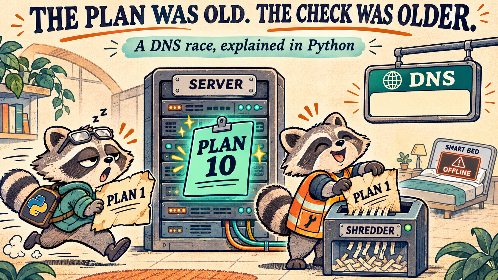

# The plan was old. The check was older.

**Reproduce a DNS race in Python. See why an old permission can outlive the state it checked.**

A delayed writer wakes up with yesterday's permission. Cleanup arrives with a shredder. The endpoint loses its address.

[**Read the code**](dns_race_toy.py) · [**Explore the 12 tests**](test_dns_race_toy.py) · [**Verified test run**](https://github.com/jenniferevangelista-de/data-engineering-lab/actions/runs/42158938939/job/127699687396) · [**AWS incident report**](https://aws.amazon.com/message/101925/)

| Runtime | Dependencies | Data | Cloud access |
| :--- | :--- | :--- | :--- |
| Python 3.10+ | Standard library only | Synthetic | None required |

*AI-generated editorial illustration. The diagram below shows the model's exact sequence.*

## Follow the race

This single-threaded simulation is inspired by the DNS automation race described in AWS's October 19–20, 2025 incident report. It makes the order of operations explicit.

```mermaid
sequenceDiagram
    autonumber
    participant A as Slow writer A
    participant E as Endpoint
    participant B as Fast writer B
    participant C as Cleanup
    A->>E: Check Plan 1 is newer
    E-->>A: Yes
    Note over A: Delayed after checking
    B->>E: Apply Plan 10
    Note over E: Active = 10
    A->>E: Apply Plan 1 using old permission
    Note over E: Active = 1
    C->>E: Remove plans older than generation 8
    Note over E: Active plan deleted; record is empty
```

## Same fixture, different outcome

| | Naive path | Guarded path |
| :--- | :--- | :--- |
| Freshness check | Once, before the delay | At the moment of the write |
| Delayed Plan 1 | Overwrites Plan 10 | Refused |
| Cleanup | Deletes every plan below the cutoff | Keeps the active plan |
| Final active generation | `1`, but its plan is gone | `10` |
| Resolved addresses | `()` | `('10.0.10.1', '10.0.10.2')` |

Two independent protections interrupt this sequence:

- **Check before writing.** `write_if_newer` refuses an older or equal generation.
- **Protect live references.** `safe_cleanup` skips the active plan, even when it is old.

Keeping an old active plan prevents an empty record in this fixture; it does not make that old plan current.

## Try it in a minute

From the repository root, run the demo:

```sh
python aws/day_002_dns_race/dns_race_toy.py
```

Expected output:

```text
naive:   active = 1 | record = ()
naive:   next update fails: active plan 1 was deleted
guarded: late write accepted = False
guarded: active = 10 | record = ('10.0.10.1', '10.0.10.2')
```

Run all 12 behavior tests:

```sh
python -m unittest discover -s aws/day_002_dns_race -p 'test_dns_race_toy.py' -v
```

No installation, API key or cloud account is needed.

## What the tests prove

| Scenario | Cases | Expected behavior |
| :--- | ---: | :--- |
| Naive sequence | 5 | Initial check passes; cleanup deletes the active plan; resolution becomes empty; next update fails; recent plans remain |
| Guarded sequence | 7 | Old/equal generations are refused; newer generation is accepted; newest record is retained; live plans survive cleanup; unused old plans are removed; an empty endpoint resolves empty |

The 12-case suite passed on Python 3.12 in [this GitHub Actions job](https://github.com/jenniferevangelista-de/data-engineering-lab/actions/runs/42158938939/job/127699687396). The simulation and test files are unchanged from that tested version.

[View subsequent workflow runs](https://github.com/jenniferevangelista-de/data-engineering-lab/actions/workflows/tests.yml).

## Where the model stops

> This is an educational simulation, not AWS's implementation or a production DNS repair.

- One endpoint, numbered generations and one thread. The code makes no network calls.
- No Route 53 or DynamoDB integration; no reproduction of the downstream EC2/NLB cascade.
- Python sequencing is not distributed atomicity. A real store must enforce version checks and protect live references within an appropriate transaction or equivalent concurrency protocol.
- Plans are assumed to exist before application. Missing plans, malformed generations, negative retention values and recovery from arbitrary corruption are outside the fixture. A missing plan can still produce an empty record.

## Open the files

| File | Purpose |
| :--- | :--- |
| [`dns_race_toy.py`](dns_race_toy.py) | Naive and guarded implementations, plus runnable demo |
| [`test_dns_race_toy.py`](test_dns_race_toy.py) | 12 reproducible behavior tests |
| [Official incident report](https://aws.amazon.com/message/101925/) | Source for the ordering problem behind the model |

[← Back to Data Engineering Lab](../../README.md)
